# Auditing Data Leakage in Medical Visual Question Answering Benchmarks

Medical visual question answering (VQA) benchmarks evaluate generalization under the assumption that test cases are not seen during training.
We audit whether this assumption holds in the official splits of SLAKE and VQA-RAD using filename matching and image similarity matching based on normalized cross-correlation.
In SLAKE, when training on both English and Chinese questions, 90.9% of English CT and MRI test images have a likely adjacent slice from the same 3D volume in the training split.
In VQA-RAD, 202 of 203 test images appear in the training split.
Reported performance on both benchmarks may therefore overestimate generalization to unseen cases.

## 1. Background

Medical vision-language models (VLMs) are commonly evaluated on medical visual question answering (VQA) benchmarks such as SLAKE ([Liu et al., 2021](#ref-liu2021slake)) and VQA-RAD ([Lau et al., 2018](#ref-lau2018dataset)).
Since the benchmarks' training splits are often included in the training data of medical VLMs, overlap between the training and test splits can inflate reported performance.
This concern is not hypothetical: such overlap has already been reported for VQA-RAD, where 202 of 203 test images also appear in the training split ([Moor et al., 2023](#ref-moor2023med)).
In this work, we audit overlap between the official splits of SLAKE and VQA-RAD using filename matching and image similarity matching to detect identical images and adjacent slices.

## 2. Methods

### 2.1 Benchmarks

We audit two medical VQA benchmarks, SLAKE and VQA-RAD.

- **SLAKE** ([Liu et al., 2021](#ref-liu2021slake)) is a bilingual (English and Chinese) medical VQA benchmark consisting of 642 radiology images and 14,028 question–answer pairs.
  Within each language, its official split divides the images into 450 training, 96 validation, and 96 test images at the image level.
  The images were collected from three public datasets: 179 chest X-rays were randomly selected from ChestX-ray8 ([Wang et al., 2017](#ref-wang2017chestx)), and 463 axial CT and MRI slices were randomly selected from 3D volumes in the Medical Segmentation Decathlon (MSD) ([Simpson et al., 2019](#ref-simpson2019large)) and CHAOS ([Kavur et al., 2021](#ref-kavur2021chaos)).
  MSD was itself collected from existing public sources, such as BraTS ([Menze et al., 2014](#ref-menze2014multimodal)) for brain tumor MRIs, LiTS ([Bilic et al., 2023](#ref-bilic2023liver)) for liver CTs, and The Cancer Imaging Archive (TCIA) ([Bakr et al., 2018](#ref-bakr2018radiogenomic)) for lung CTs.
- **VQA-RAD** ([Lau et al., 2018](#ref-lau2018dataset)) is a medical VQA benchmark consisting of 315 radiology images and 2,248 question–answer pairs written by clinicians.
  Its official split is defined at the question level, with 1,797 training and 451 test questions.
  The images (head CT/MRI, chest X-ray, and abdominal CT) were sampled from [MedPix](https://medpix.nlm.nih.gov/), one per case.

### 2.2 Leakage Detection

Our audit protocol consists of three steps: split assignment, image matching, and overlap counting.

**Step 1: Split assignment.**
Since the official splits are released as lists of question–answer pairs, we assign each image to all splits containing at least one of its questions.
For SLAKE, which is bilingual and includes both 2D X-rays and slices from 3D CT and MRI volumes, we consider three language settings and two modality settings.
For language, we use English (EN) only, English and Chinese (EN/ZH) for training and EN for validation and test, or EN/ZH for all splits.
For modality, we use all modalities (X-ray, CT, and MRI) or CT and MRI only.
For VQA-RAD, we assign images using all questions in the official training and test splits, including both original and rephrased questions.

**Step 2: Image matching.**
We match images across splits with two criteria.

- **Filename matching.**
  Two images match if they have the same filename.
  This detects the same image file appearing in multiple splits.
- **Image similarity matching.**
  To detect adjacent slices from the same 3D volume, we compare image content with normalized cross-correlation (NCC).
  NCC is invariant to linear changes in brightness and contrast, allowing it to match similar anatomy despite intensity differences.
  To compute NCC, we first convert each image to grayscale, crop it to the bounding box of its nonzero pixels (to remove zero padding, e.g., in brain MRI), and resize it to $128 \times 128$ with bilinear interpolation.
  For two flattened images $x$ and $y$ with $d = 128^2$ pixels, NCC is defined as

```math
\mathrm{NCC}(x, y) = \frac{\sum_{i=1}^{d} (x_i - \bar{x})(y_i - \bar{y})}{\sqrt{\sum_{i=1}^{d} (x_i - \bar{x})^2} \sqrt{\sum_{i=1}^{d} (y_i - \bar{y})^2}},
```

<dl><dd><dl><dd>

where $\bar{x}$ and $\bar{y}$ are the mean pixel intensities of $x$ and $y$.
We compute NCC for all pairs of images across splits and consider an image pair a match if $\mathrm{NCC}(x, y) \geq 0.9$.
Because identical images have $\mathrm{NCC} = 1$, image similarity matches include all filename matches.

</dd></dl></dd></dl>

**Step 3: Overlap counting.**
We count the number of images in a query split that match at least one image in a reference split.
An image is counted once even if it matches multiple reference images, e.g., several adjacent slices from the same volume.
We consider three reference–query pairs: train–validation, train–test, and validation–test (train–test only for VQA-RAD).
We report these counts (and percentages) as a cross-split overlap matrix over the training, validation, and test splits.

## 3. Results

### 3.1 SLAKE

<a id="fig-1"></a>
<p align="center">
  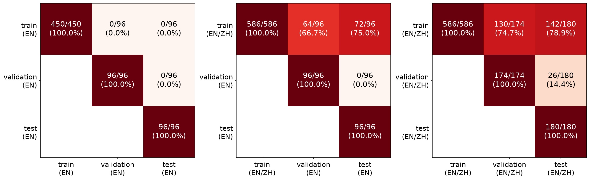<br>
  <em>(a) Filename matching (all modalities)</em><br><br>
  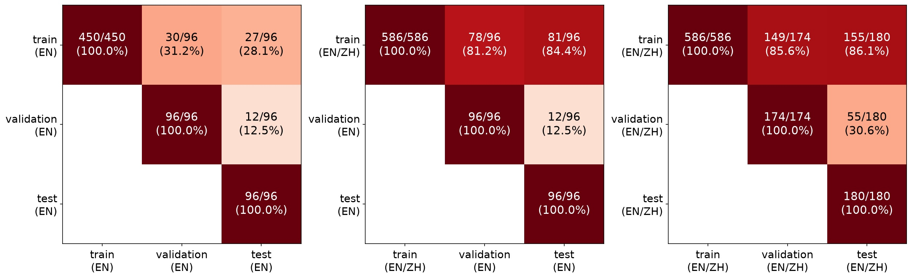<br>
  <em>(b) Image similarity matching, NCC ≥ 0.9 (all modalities)</em><br><br>
  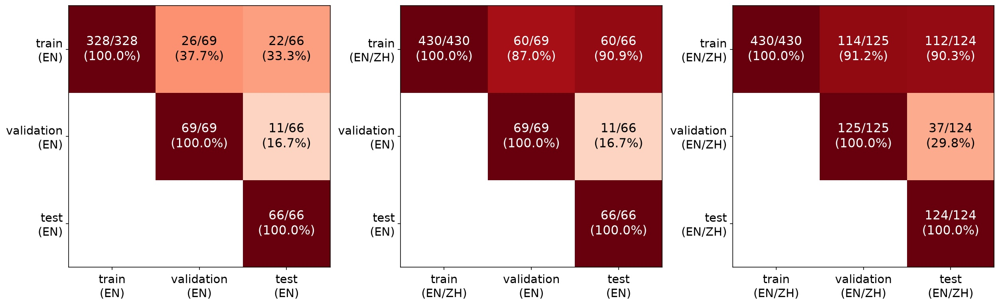<br>
  <em>(c) Image similarity matching, NCC ≥ 0.9 (CT and MRI)</em>
</p>

<p align="center"><b>Figure 1.</b> Cross-split overlap matrices of SLAKE. From left to right, the panels in each row use English questions only, both languages for training and English only for validation and test, and both languages in all splits.</p>

**Filename matching.**
[Figure 1](#fig-1)(a) shows the cross-split overlap matrices of SLAKE by filename matching for all modalities.
In the English-only setting (left panel), no image file is shared across splits.
When training on both languages (middle panel), 72 of 96 test images (75.0%) also appear in the training split, because the English and Chinese questions on an image often belong to different splits.
When both languages are used in all splits (right panel), 142 of 180 test images (78.9%) also appear in the training split.

<a id="fig-2"></a>
<div align="center">
<table>
  <tr>
    <td align="center">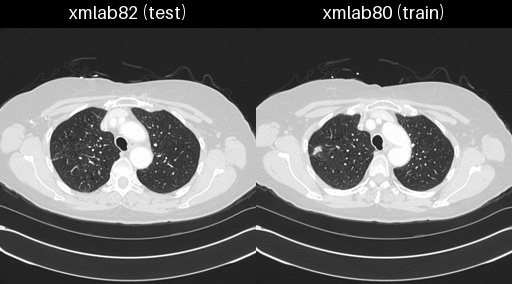<br><em>(a) NCC = 0.952</em></td>
    <td align="center">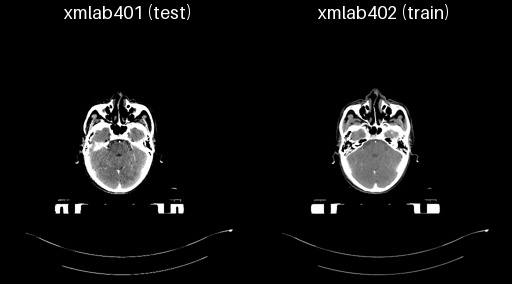<br><em>(b) NCC = 0.948</em></td>
    <td align="center">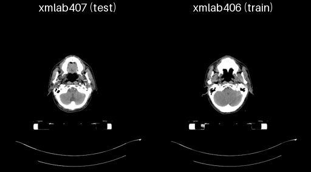<br><em>(c) NCC = 0.908</em></td>
  </tr>
  <tr>
    <td align="center">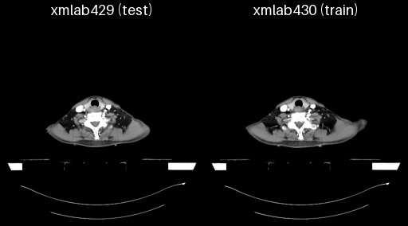<br><em>(d) NCC = 0.963</em></td>
    <td align="center">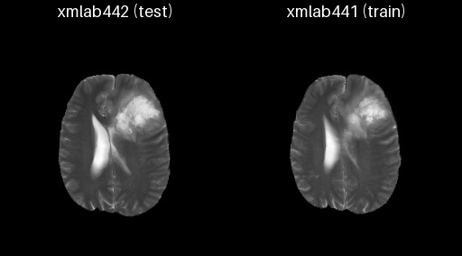<br><em>(e) NCC = 0.932</em></td>
    <td align="center">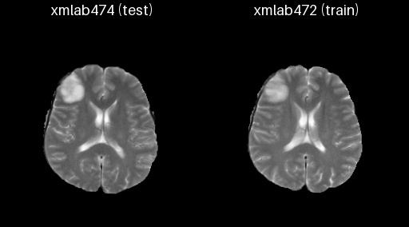<br><em>(f) NCC = 0.955</em></td>
  </tr>
  <tr>
    <td align="center">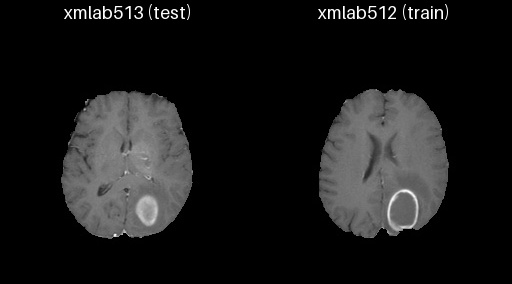<br><em>(g) NCC = 0.901</em></td>
    <td align="center">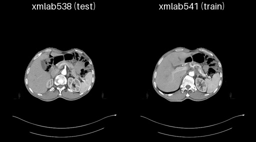<br><em>(h) NCC = 0.920</em></td>
    <td align="center">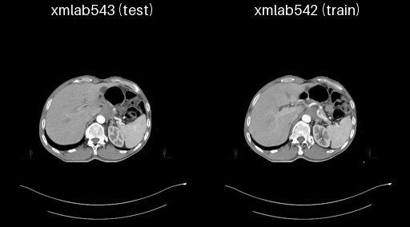<br><em>(i) NCC = 0.961</em></td>
  </tr>
  <tr>
    <td align="center">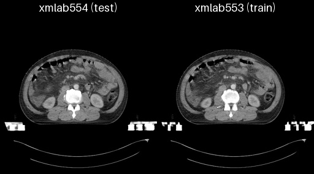<br><em>(j) NCC = 0.956</em></td>
    <td align="center">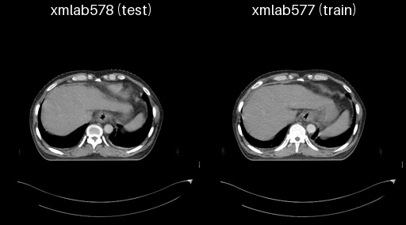<br><em>(k) NCC = 0.935</em></td>
    <td align="center">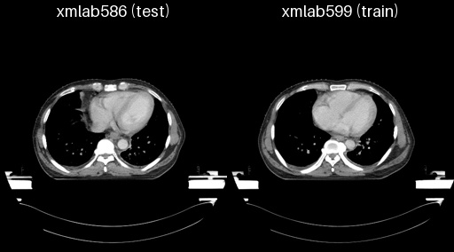<br><em>(l) NCC = 0.901</em></td>
  </tr>
</table>
</div>

<p align="center"><b>Figure 2.</b> Examples of test images (left in each pair) and their most similar training images (right).</p>

**Image similarity matching.**
[Figure 2](#fig-2) shows examples of test images in SLAKE and their most similar training images.
Although their filenames differ, each pair has nearly identical anatomy, suggesting adjacent slices from the same 3D volume.
In [Figure 2](#fig-2)(l), the images between the pair (xmlab588–598; xmlab587 is in the validation split) appear to be slices from the same volume with a different CT window.
Definitive verification would require the original scan metadata, which is not publicly available.
We qualitatively inspected all 22 CT and MRI test images with a match in the training split under the English-only setting, and each appears to come from the same 3D volume as its match.
We therefore treat a match with NCC ≥ 0.9 as likely from the same case.

[Figure 1](#fig-1)(b) shows the cross-split overlap matrices of SLAKE by image similarity matching for all modalities.
In the English-only setting (left panel), 27 of 96 test images (28.1%) have an image likely from the same case in the training split.
This rises to 81 of 96 (84.4%) when training on both languages (middle panel) and to 155 of 180 (86.1%) when both languages are used in all splits (right panel).
[Figure 1](#fig-1)(c) shows the same matrices for CT and MRI only.
In the English-only setting (left panel), 22 of 66 test images (33.3%) are matched to a likely adjacent slice in the training split.
This rises to 60 of 66 (90.9%) when training on both languages (middle panel) and to 112 of 124 (90.3%) when both languages are used in all splits (right panel).

### 3.2 VQA-RAD

<a id="fig-3"></a>
<p align="center">
  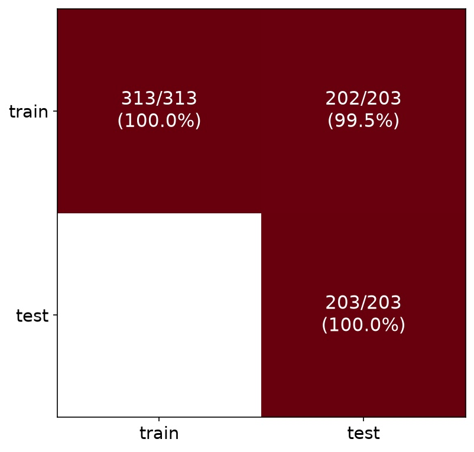
</p>

<p align="center"><b>Figure 3.</b> Cross-split overlap matrix of VQA-RAD by filename matching.</p>

[Figure 3](#fig-3) shows the cross-split overlap matrix of VQA-RAD by filename matching.
Because VQA-RAD is split at the question level, questions on the same image are often assigned to both splits.
In total, 202 of 203 test images (99.5%) also appear in the training split, consistent with prior work ([Moor et al., 2023](#ref-moor2023med)).

## 4. Discussion

Our audit reveals substantial train–test leakage in both SLAKE and VQA-RAD.
The actual leakage in SLAKE may be higher than our estimate, because NCC cannot reliably match different X-rays of the same patient (ChestX-ray8 provides multiple X-rays per patient) and may fail to detect brain MRI slices from the same volume that are sampled at distant axial positions.
Beyond our audit, leakage can also occur when a benchmark shares its image source with medical VLM training data.
PMC-VQA ([Zhang et al., 2023](#ref-zhang2023pmc)), sourced from PubMed Central (PMC) ([Roberts, 2001](#ref-roberts2001pubmed); [Lin et al., 2023](#ref-lin2023pmc)), and VQA-RAD (including its re-split version; [Yang et al., 2024](#ref-yang2024advancing)), sourced from MedPix ([Siragusa et al., 2025](#ref-siragusa2025medpix)), may be exposed to such leakage.
Similarly, the OmniMedVQA benchmark ([Hu et al., 2024](#ref-hu2024omnimedvqa)) is built from 73 medical datasets, some of which may also be used to train medical VLMs.
Our findings, together with these concerns, suggest that performance reported on these benchmarks should be interpreted with caution, as it may overestimate generalization to unseen cases.

## References

- <a id="ref-bakr2018radiogenomic"></a>Shaimaa Bakr, Olivier Gevaert, Sebastian Echegaray, Kelsey Ayers, Mu Zhou, Majid Shafiq, Hong Zheng, Jalen Anthony Benson, Weiruo Zhang, Ann NC Leung, et al. A radiogenomic dataset of non-small cell lung cancer. *Scientific data*, 5(1):180202, 2018.
- <a id="ref-bilic2023liver"></a>Patrick Bilic, Patrick Christ, Hongwei Bran Li, Eugene Vorontsov, Avi Ben-Cohen, Georgios Kaissis, Adi Szeskin, Colin Jacobs, Gabriel Efrain Humpire Mamani, Gabriel Chartrand, et al. The liver tumor segmentation benchmark (lits). *Medical image analysis*, 84:102680, 2023.
- <a id="ref-hu2024omnimedvqa"></a>Yutao Hu, Tianbin Li, Quanfeng Lu, Wenqi Shao, Junjun He, Yu Qiao, and Ping Luo. Omnimedvqa: A new large-scale comprehensive evaluation benchmark for medical lvlm. In *2024 IEEE/CVF Conference on Computer Vision and Pattern Recognition (CVPR)*, pages 22170–22183. IEEE, 2024.
- <a id="ref-kavur2021chaos"></a>A Emre Kavur, N Sinem Gezer, Mustafa Barış, Sinem Aslan, Pierre-Henri Conze, Vladimir Groza, Duc Duy Pham, Soumick Chatterjee, Philipp Ernst, Savaş Özkan, et al. Chaos challenge-combined (ct-mr) healthy abdominal organ segmentation. *Medical image analysis*, 69:101950, 2021.
- <a id="ref-lau2018dataset"></a>Jason J Lau, Soumya Gayen, Asma Ben Abacha, and Dina Demner-Fushman. A dataset of clinically generated visual questions and answers about radiology images. *Scientific data*, 5(1):180251, 2018.
- <a id="ref-lin2023pmc"></a>Weixiong Lin, Ziheng Zhao, Xiaoman Zhang, Chaoyi Wu, Ya Zhang, Yanfeng Wang, and Weidi Xie. Pmc-clip: Contrastive language-image pre-training using biomedical documents. In *international conference on medical image computing and computer-assisted intervention*, pages 525–536. Springer, 2023.
- <a id="ref-liu2021slake"></a>Bo Liu, Li-Ming Zhan, Li Xu, Lin Ma, Yan Yang, and Xiao-Ming Wu. Slake: A semantically-labeled knowledge-enhanced dataset for medical visual question answering. In *2021 IEEE 18th international symposium on biomedical imaging (ISBI)*, pages 1650–1654. IEEE, 2021.
- <a id="ref-menze2014multimodal"></a>Bjoern H Menze, Andras Jakab, Stefan Bauer, Jayashree Kalpathy-Cramer, Keyvan Farahani, Justin Kirby, Yuliya Burren, Nicole Porz, Johannes Slotboom, Roland Wiest, et al. The multimodal brain tumor image segmentation benchmark (brats). *IEEE transactions on medical imaging*, 34(10):1993–2024, 2014.
- <a id="ref-moor2023med"></a>Michael Moor, Qian Huang, Shirley Wu, Michihiro Yasunaga, Yash Dalmia, Jure Leskovec, Cyril Zakka, Eduardo Pontes Reis, and Pranav Rajpurkar. Med-flamingo: a multimodal medical few-shot learner. In *Machine learning for health (ML4H)*, pages 353–367. PMLR, 2023.
- <a id="ref-roberts2001pubmed"></a>Richard J Roberts. Pubmed central: The genbank of the published literature. *Proceedings of the National Academy of Sciences*, 98(2):381–382, 2001.
- <a id="ref-simpson2019large"></a>Amber L Simpson, Michela Antonelli, Spyridon Bakas, Michel Bilello, Keyvan Farahani, Bram Van Ginneken, Annette Kopp-Schneider, Bennett A Landman, Geert Litjens, Bjoern Menze, et al. A large annotated medical image dataset for the development and evaluation of segmentation algorithms. *arXiv preprint arXiv:1902.09063*, 2019.
- <a id="ref-siragusa2025medpix"></a>Irene Siragusa, Salvatore Contino, Massimo La Ciura, Rosario Alicata, and Roberto Pirrone. Medpix 2.0: a comprehensive multimodal biomedical data set for advanced ai applications with retrieval augmented generation and knowledge graphs. *Data Science and Engineering*, pages 1–17, 2025.
- <a id="ref-wang2017chestx"></a>Xiaosong Wang, Yifan Peng, Le Lu, Zhiyong Lu, Mohammadhadi Bagheri, and Ronald M Summers. Chestx-ray8: Hospital-scale chest x-ray database and benchmarks on weakly-supervised classification and localization of common thorax diseases. In *Proceedings of the IEEE conference on computer vision and pattern recognition*, pages 2097–2106, 2017.
- <a id="ref-yang2024advancing"></a>Lin Yang, Shawn Xu, Andrew Sellergren, Timo Kohlberger, Yuchen Zhou, Ira Ktena, Atilla Kiraly, Faruk Ahmed, Farhad Hormozdiari, Tiam Jaroensri, et al. Advancing multimodal medical capabilities of gemini. *arXiv preprint arXiv:2405.03162*, 2024.
- <a id="ref-zhang2023pmc"></a>Xiaoman Zhang, Chaoyi Wu, Ziheng Zhao, Weixiong Lin, Ya Zhang, Yanfeng Wang, and Weidi Xie. Pmc-vqa: Visual instruction tuning for medical visual question answering. *arXiv preprint arXiv:2305.10415*, 2023.

---

## Reproducing the Audit

### Data
- SLAKE: `git clone https://huggingface.co/datasets/BoKelvin/SLAKE` (unzip `imgs.zip`)
- VQA-RAD: download from [OSF](https://osf.io/89kps/overview) into `./VQA_RAD`

### Usage

```bash
python audit_image_overlap.py
```
